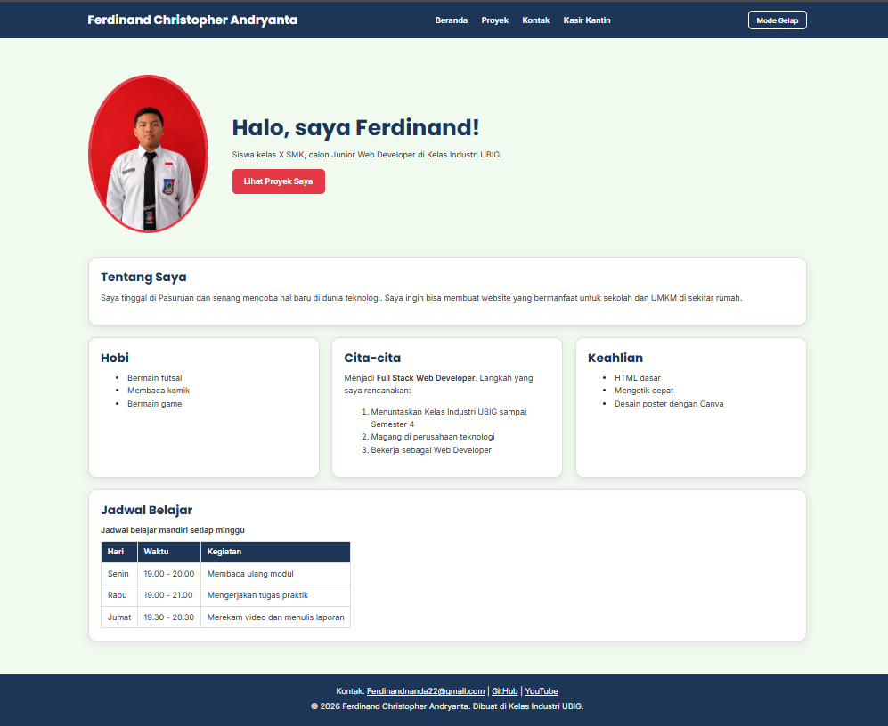

# Portofolio Ferdinand Christopher Andryanta
Website portofolio pribadi yang saya buat di Kelas Industri UBIG
(Paket 1, Minggu 01 sampai 05).
Website ini tampil rapi di ponsel, tablet, dan laptop.

---

## Tampilan

---

## Lighthouse Beranda
![Nilai Lighthouse pada halaman beranda]
---

## Fitur
- Halaman **Beranda** berisi profil, hobi, cita-cita, keahlian, dan jadwal belajar
- Halaman **Proyek** berisi daftar proyek dalam bentuk kartu
- Halaman **Kontak** berisi form untuk menghubungi saya
- Tampilan responsif dengan Flexbox dan *media query*

---

## Fitur
- Halaman **Beranda** berisi profil, hobi, cita-cita, keahlian, dan
jadwal belajar
- Halaman **Proyek** berisi daftar proyek dalam bentuk kartu
- Halaman **Kontak** berisi form untuk menghubungi saya
- Tampilan responsif dengan Flexbox dan *media query*

---

## Pengujian Lighthouse

Pengujian website dilakukan menggunakan Lighthouse untuk memeriksa:

- Performance
- Accessibility
- Best Practices
- SEO

---

## Hasil Pengujian Lighthouse

Pengujian dilakukan menggunakan Lighthouse pada tiga halaman website.

| Halaman | Performance | Accessibility | Best Practices | SEO |
|---|---:|---:|---:|---:|
| Beranda | 87 | 94 | 96 | 91 |
| Proyek | 83 | 86 | 96 | 91 |
| Kontak | 100 | 93 | 96 | 90 |

---

## Teknologi
- HTML5
- CSS3 (Flexbox dan media query)
- Git dan GitHub
- VS Code dan Live Server
- JavaScript
- JSON
- GitHub API

---

## Tautan
- Website: https://portofolio-ferdinand-liard.vercel.app/
- Dibuat oleh: Ferdinand Christopher Andryanta, SMKN 1 Pasuruan